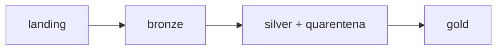

Pipeline incremental em Databricks (Delta Lake) com camadas bronze, silver e gold para dados de cartão:
clientes, contas, cartões, transações e estornos.

Massa fictícia com 6 cargas
Os problemas colocados de propósito estão em [`docs/massa_de_dados.md`](docs/massa_de_dados.md).

## Arquitetura

- **bronze**: os CSVs como chegaram, tudo texto, com arquivo de origem, data de referência, horário da carga e hash da linha.
- **silver**: dados tipados, sem duplicadas e válidos. O que tem erro vai pra uma tabela de quarentena com o motivo.
- **gold**: `gold_transacoes_cartao`, `gold_resumo_cliente_mes`, `gold_ranking_estabelecimento` e `gold_alertas_qualidade`.

## Como executar

1. Rodar `notebooks/00_setup` (cria catálogo, schemas e volume).
2. Subir os CSVs de `data/landing/` no volume `/Volumes/novarota/bronze/landing/`, uma pasta por data.
3. Rodar os notebooks nesta ordem:
   `01_bronze` → `SilverClientes` → `SilverContas` → `SilverCartoes` → `SilverTransacoes` → `SilverEstornos` →
   `GoldTransacoesCartao` → `GoldResumoClienteMes`, `GoldRankingEstabelecimento` e `GoldAlertasQualidade`.

## Decisões

- **Incremental**: cada camada só processa as cargas novas. A silver e a gold usam tabelas de controle pra saber o que já foi processado.
- **MERGE**: nas dimensões (clientes, contas, cartões), atualiza se a versão for mais nova. Nos fatos (transações, estornos), só insere o que é novo.
- **Estornos**: a transação estornada fica marcada (`fl_estornada`) e não entra nos indicadores da gold.
- **Gold**: recalcula só os meses afetados pelas cargas novas.
- **Particionamento**: não particionei, as tabelas são pequenas.
- **Schema evolution**: a bronze aceita coluna nova (`mergeSchema`). A silver lista as colunas na query, então coluna nova só entra quando for tratada.

## Premissas

- A chave de cada tabela é o seu `id`.
- Todo estorno é total.
- Cartão cancelado e transação atrasada não são erro.

## Limitações e próximos passos

- Transação que chega antes do cartão fica na quarentena e não é reprocessada sozinha.
- CPF validado só pelo formato (11 dígitos).
- Nesta versão não tem testes automatizados, só as conferências dentro dos notebooks.
- Próximos passos: criar tabela dimensão tipo SCD2 para criar indicadores de atividades de clientes com referências históricas.

## Evidencias

    - Diagrama do Job

    - Cargas

    - Qualidade

